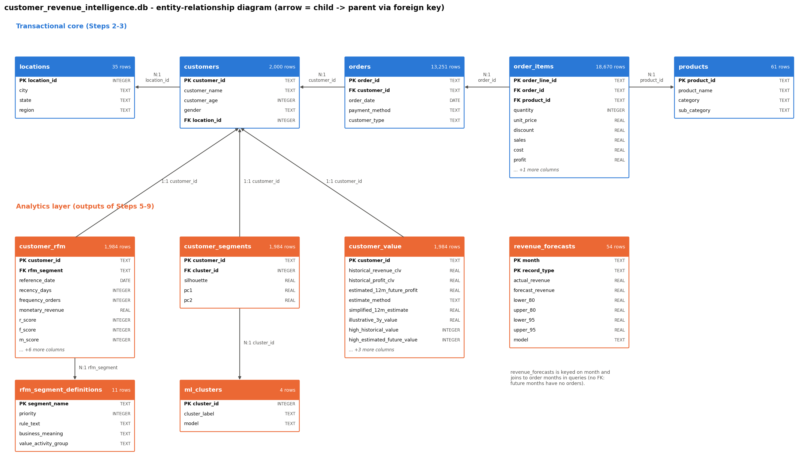

# SQL Business Analytics & Database Integration - Step 10

> **SYNTHETIC DATA - generated for academic demonstration only.** Every number below is read from a SQL result set produced by `sql/analysis_queries.sql` or `sql/business_queries.sql` on the project database.

## 1. Database objective

Hold the cleaned transactions and the customer-level outputs of Steps 5-9 in one relational database, so business questions can be answered with SQL (joins, aggregations, window functions) and so the later Power BI and Streamlit layers can read one consistent source.

## 2. Database design

- **Technology:** SQLite 3.45.1 (Python's built-in `sqlite3`; no server needed). File: `data/customer_revenue_intelligence.db`.
- **Model:** third normal form transactional core + an analytics layer that stores only what the Python steps produced (scores, labels, estimates). Anything recomputable from transactions is computed in SQL.
- **Revenue rule:** Delivered lines only, encoded once in the view `vw_delivered_sales`; `vw_sales_flat` re-creates the original one-row-per-line layout (all statuses).
- **Constraints:** primary keys on every table, 9 foreign keys, CHECK constraints for domains (regions, categories, statuses, score ranges, discount 0-40%) and business rules (sales = qty x price x (1 - discount); profit = sales - cost; rfm_score = r + f + m).



## 3. Tables

| Table | Layer | Rows | Columns | Primary_Key | Foreign_Keys |
|---|---|---|---|---|---|
| locations | Transactional | 35 | 4 | location_id | - |
| customers | Transactional | 2000 | 5 | customer_id | location_id -> locations.location_id |
| products | Transactional | 61 | 4 | product_id | - |
| orders | Transactional | 13251 | 5 | order_id | customer_id -> customers.customer_id |
| order_items | Transactional | 18670 | 10 | order_line_id | product_id -> products.product_id; order_id -> orders.order_id |
| rfm_segment_definitions | Analytics | 11 | 5 | segment_name | - |
| customer_rfm | Analytics | 1984 | 15 | customer_id | rfm_segment -> rfm_segment_definitions.segment_name; customer_id -> customers.customer_id |
| ml_clusters | Analytics | 4 | 3 | cluster_id | - |
| customer_segments | Analytics | 1984 | 5 | customer_id | cluster_id -> ml_clusters.cluster_id; customer_id -> customers.customer_id |
| customer_value | Analytics | 1984 | 12 | customer_id | customer_id -> customers.customer_id |
| revenue_forecasts | Analytics | 54 | 9 | month, record_type | - |

Column names and SQLite types for every table: `outputs/tables/sql_table_catalog.csv`.

## 4. Relationships

- `locations` 1 - N `customers` (location_id)
- `customers` 1 - N `orders` (customer_id)
- `orders` 1 - N `order_items` (order_id); `products` 1 - N `order_items` (product_id)
- `customers` 1 - 1 `customer_rfm`, `customer_segments`, `customer_value` (customer_id; only the 1,984 customers with a Delivered order have rows)
- `rfm_segment_definitions` 1 - N `customer_rfm` (rfm_segment); `ml_clusters` 1 - N `customer_segments` (cluster_id)
- `revenue_forecasts` (month, record_type) joins to order months in queries; no FK because future months have no orders.

## 5. Data loading process

`python sql/load_database.py` (calls `src/database.py`):
1. delete and re-create `data/customer_revenue_intelligence.db`; 2. run `sql/schema.sql`; 3. split the cleaned CSV into the five transactional tables (after checking that order- and customer-level attributes are single-valued); 4. load RFM, segment definitions, clusters, CLV and forecasts from Steps 5-9; 5. validate; 6. save. The Step 3 file `data/processed/revenue_intelligence.db` is replaced by this database (one source of truth).

## 6. SQL analysis methodology

57 queries in two files, each with a header (`-- name`, `-- section`, `-- title` or `-- question / purpose / interpretation`). `src/sql_analytics.py` executes them, saves every result to `outputs/tables/sql/<name>.csv`, and builds charts from those result sets. Python performs no business calculation. The reference date is computed in SQL (last order date + 1 day); customers are shown by ID only.

| Query | File | Section | Title_or_Question | Rows |
|---|---|---|---|---|
| rev_kpi_summary | analysis_queries.sql | Revenue | Headline KPIs - total revenue, profit, margin, orders, customers, AOV | 1 |
| rev_order_status | analysis_queries.sql | Revenue | Order lines and booked value by status (why only Delivered lines count as revenue) | 3 |
| rev_by_year | analysis_queries.sql | Revenue | Revenue, profit and margin by year with year-over-year growth | 3 |
| rev_by_quarter | analysis_queries.sql | Revenue | Quarterly revenue with quarter-on-quarter and same-quarter-last-year growth | 12 |
| rev_margin_by_year_category | analysis_queries.sql | Revenue | Profit margin by year and category (is margin stable over time?) | 18 |
| cust_top_revenue | analysis_queries.sql | Customer | Top 20 customers by revenue (with rank and share of total) | 20 |
| cust_top_profit | analysis_queries.sql | Customer | Top 20 customers by profit (with margin) | 20 |
| cust_most_frequent | analysis_queries.sql | Customer | Most frequent customers (10+ delivered orders) | 25 |
| cust_highest_aov | analysis_queries.sql | Customer | Highest average order value (customers with >= 3 orders, to avoid one-off noise) | 20 |
| cust_new_vs_existing | analysis_queries.sql | Customer | New vs existing customers (customer type on each customer's first order) | 2 |
| cust_acquired_by_year | analysis_queries.sql | Customer | Customers by year of first delivered purchase (cohorts) and their revenue to date | 3 |
| cust_frequency_distribution | analysis_queries.sql | Customer | Customer purchase frequency distribution (delivered orders per customer) | 5 |
| cust_revenue_concentration | analysis_queries.sql | Customer | Customer revenue concentration - rank, cumulative revenue and cumulative % (Pareto) | 1984 |
| cust_concentration_summary | analysis_queries.sql | Customer | Share of revenue held by the top 1% / 5% / 10% / 20% / 50% of customers | 5 |
| cust_inactive | analysis_queries.sql | Customer | Customers with no purchase for >= 90 / 180 / 365 days (inactivity, NOT churn - see Step 7) | 3 |
| seg_rfm_summary | analysis_queries.sql | Segmentation | RFM segment summary - customers, revenue, profit, average revenue / frequency / recency, contribution % | 11 |
| seg_value_activity_groups | analysis_queries.sql | Segmentation | Revenue and customers by value-activity group (rolled up from the RFM segment definitions) | 4 |
| seg_ml_cluster_summary | analysis_queries.sql | Segmentation | ML cluster size, revenue, profit and contribution (Step 6 K-Means) | 4 |
| seg_rfm_vs_cluster | analysis_queries.sql | Segmentation | RFM segment x ML cluster - customer counts (how the two segmentations overlap) | 11 |
| seg_value_by_cluster | analysis_queries.sql | Segmentation | Observed vs estimated customer value by ML cluster (Step 7 CLV) | 4 |
| prod_top_revenue | analysis_queries.sql | Product | Top 15 products by revenue | 15 |
| prod_top_profit | analysis_queries.sql | Product | Top 15 products by profit | 15 |
| prod_top_quantity | analysis_queries.sql | Product | Best-selling products by units sold | 15 |
| prod_category_performance | analysis_queries.sql | Product | Category revenue, profit, margin and share | 6 |
| prod_subcategory_performance | analysis_queries.sql | Product | Sub-category revenue, profit and margin (ranked within category) | 26 |
| prod_profitability | analysis_queries.sql | Product | Product profitability - quantity, revenue, cost, profit, margin, average discount, average price | 61 |
| prod_avg_selling_price | analysis_queries.sql | Product | Average selling price, list price and discount by category | 6 |
| prod_discount_bands | analysis_queries.sql | Product | Discount level vs revenue, profit and margin | 5 |
| prod_investigate | analysis_queries.sql | Product | Products that may need investigation (margin far below their category, or high return/cancel rate) | 10 |
| reg_performance | analysis_queries.sql | Regional | Revenue, profit, orders, customers and AOV by region | 5 |
| reg_category_matrix | analysis_queries.sql | Regional | Category performance by region (revenue, margin, share of the region's revenue) | 30 |
| reg_top_states | analysis_queries.sql | Regional | Top 3 states by revenue within each region | 14 |
| reg_customers_without_orders | analysis_queries.sql | Regional | Registered customers by region and how many have a Delivered order (LEFT JOIN) | 5 |
| time_monthly | analysis_queries.sql | Time | Monthly revenue, profit, orders and customers with month-over-month and year-over-year growth | 36 |
| time_best_worst_months | analysis_queries.sql | Time | Highest- and lowest-revenue months | 6 |
| time_ytd_running_total | analysis_queries.sql | Time | Year-to-date running revenue by month (running total that restarts each year) | 36 |
| time_month_of_year | analysis_queries.sql | Time | Average revenue by calendar month across years (seasonal pattern), with each year's value | 12 |
| BQ01 | business_queries.sql | Business question | Which customers generate the highest revenue? | 10 |
| BQ02 | business_queries.sql | Business question | Which customer segments contribute the most revenue? | 11 |
| BQ03 | business_queries.sql | Business question | Which products generate high revenue but relatively low profit? | 11 |
| BQ04 | business_queries.sql | Business question | Which categories have the highest profit margins? | 6 |
| BQ05 | business_queries.sql | Business question | Which regions generate the highest revenue? | 5 |
| BQ06 | business_queries.sql | Business question | Which customers have high historical value but low recent activity? | 52 |
| BQ07 | business_queries.sql | Business question | Which products have high sales volume but low profitability? | 2 |
| BQ08 | business_queries.sql | Business question | How does discount level relate to profitability? | 24 |
| BQ09 | business_queries.sql | Business question | Which months generate the highest revenue? | 9 |
| BQ10 | business_queries.sql | Business question | What percentage of total revenue comes from high-value customers? | 2 |
| BQ11 | business_queries.sql | Business question | Which ML cluster earns the most profit per customer, and how much of total profit does each hold? | 4 |
| BQ12 | business_queries.sql | Business question | How much revenue comes from repeat customers versus single-purchase customers? | 2 |
| BQ13 | business_queries.sql | Business question | Which payment methods have the highest order value and the highest return/cancellation rates? | 6 |
| BQ14 | business_queries.sql | Business question | Which categories lose the most value to returns and cancellations? | 6 |
| BQ15 | business_queries.sql | Business question | How has the active customer base changed year over year (retained, new and returning customers)? | 3 |
| BQ16 | business_queries.sql | Business question | Which region-category combinations have margins well below the category's national margin? | 30 |
| BQ17 | business_queries.sql | Business question | How long do repeat customers typically wait between orders? | 1 |
| BQ18 | business_queries.sql | Business question | Which customers are estimated to be most valuable next year but are not yet Champions? | 20 |
| BQ19 | business_queries.sql | Business question | How concentrated is revenue across products? | 20 |
| BQ20 | business_queries.sql | Business question | How did the Step 9 forecasts compare with actual revenue, and what do they imply for the next six months? | 18 |

## 7. Business questions

**BQ01 - Which customers generate the highest revenue?**  
Purpose: Identify the accounts the business depends on most, for key-account management.  
How to read it: Read revenue_rank and pct_of_total_revenue; compare the top 10's combined share with BQ10 to judge dependence on a few customers. rfm_segment / cluster show whether they are still active.  
SQL techniques: LEFT JOIN, CTE (WITH), Window function, Ranking (RANK / ROW_NUMBER / NTILE), Percentage contribution (SUM() OVER ()), GROUP BY aggregation. Result: `outputs/tables/sql/BQ01.csv` (10 rows).

**BQ02 - Which customer segments contribute the most revenue?**  
Purpose: Size each RFM segment's commercial weight to prioritise segment strategies.  
How to read it: Compare revenue_contribution_pct with customer_pct - segments whose revenue share far exceeds their customer share are high-value; the reverse indicates low-value or inactive segments.  
SQL techniques: INNER JOIN, CTE (WITH), Window function, Ranking (RANK / ROW_NUMBER / NTILE), Percentage contribution (SUM() OVER ()), GROUP BY aggregation. Result: `outputs/tables/sql/BQ02.csv` (11 rows).

**BQ03 - Which products generate high revenue but relatively low profit?**  
Purpose: Find revenue drivers that contribute little profit (pricing, cost or discount review).  
How to read it: Products in the top revenue quartile whose margin is in the bottom margin quartile; margin_gap_vs_category shows how far below their own category they sit.  
SQL techniques: CTE (WITH), Subquery, Window function, Ranking (RANK / ROW_NUMBER / NTILE), GROUP BY aggregation. Result: `outputs/tables/sql/BQ03.csv` (11 rows).

**BQ04 - Which categories have the highest profit margins?**  
Purpose: Understand where each rupee of revenue earns the most profit (mix and promotion planning).  
How to read it: Rank by profit_margin_pct but read it together with revenue_share_pct: a high-margin category with a small share has limited absolute impact.  
SQL techniques: Window function, Ranking (RANK / ROW_NUMBER / NTILE), Percentage contribution (SUM() OVER ()), GROUP BY aggregation. Result: `outputs/tables/sql/BQ04.csv` (6 rows).

**BQ05 - Which regions generate the highest revenue?**  
Purpose: Allocate regional sales and marketing effort.  
How to read it: Revenue share shows scale; revenue_per_customer and AOV show whether a region is large because of more customers or higher spend per customer.  
SQL techniques: Window function, Ranking (RANK / ROW_NUMBER / NTILE), Percentage contribution (SUM() OVER ()), GROUP BY aggregation. Result: `outputs/tables/sql/BQ05.csv` (5 rows).

**BQ06 - Which customers have high historical value but low recent activity?**  
Purpose: Build a re-engagement list of valuable customers who have gone quiet (potentially at-risk, not churned).  
How to read it: High historical value = top 20% historical profit (Step 7 flag); low recent activity = no purchase for >= 180 days before the reference date (computed here). Sorted by lifetime revenue; estimated_12m_profit is a model estimate, not a promise.  
SQL techniques: INNER JOIN, CTE (WITH), Subquery, GROUP BY aggregation, Date functions. Result: `outputs/tables/sql/BQ06.csv` (52 rows).

**BQ07 - Which products have high sales volume but low profitability?**  
Purpose: Flag popular products whose unit economics may need attention (price, cost, discount).  
How to read it: Top-quartile units sold AND bottom-half margin. Popular but thin-margin items can still be strategic (traffic drivers); this is a list for review, not a verdict.  
SQL techniques: CTE (WITH), Window function, Ranking (RANK / ROW_NUMBER / NTILE), GROUP BY aggregation. Result: `outputs/tables/sql/BQ07.csv` (2 rows).

**BQ08 - How does discount level relate to profitability?**  
Purpose: Inform discount policy by showing margin and loss-making lines at each discount level, within category.  
How to read it: Compare margin across discount bands WITHIN each category (the category mix differs by band). A lower margin at higher discounts is an association; it does not prove discounts cause lower profit.  
SQL techniques: CASE WHEN, Window function, Percentage contribution (SUM() OVER ()), GROUP BY aggregation. Result: `outputs/tables/sql/BQ08.csv` (24 rows).

**BQ09 - Which months generate the highest revenue?**  
Purpose: Plan inventory, staffing and campaigns around recurring peaks.  
How to read it: rank_in_year shows whether the same calendar month leads every year (a recurring peak) or only once (a one-off).  
SQL techniques: CTE (WITH), Window function, Ranking (RANK / ROW_NUMBER / NTILE), Percentage contribution (SUM() OVER ()), GROUP BY aggregation, Date functions. Result: `outputs/tables/sql/BQ09.csv` (9 rows).

**BQ10 - What percentage of total revenue comes from high-value customers?**  
Purpose: Quantify revenue concentration for risk and retention planning.  
How to read it: Two definitions are shown side by side - top 20% of customers by revenue (NTILE) and the Step 7 'high historical value' flag (top 20% by profit). Similar shares mean the conclusion does not depend on the definition.  
SQL techniques: INNER JOIN, CASE WHEN, CTE (WITH), Subquery, Window function, Ranking (RANK / ROW_NUMBER / NTILE), GROUP BY aggregation, UNION ALL. Result: `outputs/tables/sql/BQ10.csv` (2 rows).

**BQ11 - Which ML cluster earns the most profit per customer, and how much of total profit does each hold?**  
Purpose: Connect the Step 6 segmentation to profitability for resource allocation.  
How to read it: profit_per_customer shows intensity, profit_share_pct shows weight; a cluster can be important because it is large rather than rich.  
SQL techniques: INNER JOIN, Window function, Percentage contribution (SUM() OVER ()), GROUP BY aggregation. Result: `outputs/tables/sql/BQ11.csv` (4 rows).

**BQ12 - How much revenue comes from repeat customers versus single-purchase customers?**  
Purpose: Show the value of the second purchase for onboarding and retention.  
How to read it: Compare pct_of_revenue with pct_of_customers for each group.  
SQL techniques: CASE WHEN, CTE (WITH), Window function, Percentage contribution (SUM() OVER ()), GROUP BY aggregation. Result: `outputs/tables/sql/BQ12.csv` (2 rows).

**BQ13 - Which payment methods have the highest order value and the highest return/cancellation rates?**  
Purpose: Inform checkout and payment-policy decisions (e.g. COD handling).  
How to read it: A payment method with a high return/cancel rate is associated with lost revenue; causes (customer mix, product mix) need further investigation.  
SQL techniques: LEFT JOIN, CASE WHEN, GROUP BY aggregation. Result: `outputs/tables/sql/BQ13.csv` (6 rows).

**BQ14 - Which categories lose the most value to returns and cancellations?**  
Purpose: Target return-reduction and quality initiatives where the lost value is largest.  
How to read it: lost_value is the booked value (qty x price x (1 - discount)) of Returned + Cancelled lines; compare lost_pct_of_booked across categories.  
SQL techniques: INNER JOIN, CASE WHEN, GROUP BY aggregation. Result: `outputs/tables/sql/BQ14.csv` (6 rows).

**BQ15 - How has the active customer base changed year over year (retained, new and returning customers)?**  
Purpose: Separate growth from acquisition vs retention.  
How to read it: retained = active this year and last year; new = first ever purchase this year; reactivated = active this year, not last year, but bought before. retention_rate_pct = retained / active last year.  
SQL techniques: INNER JOIN, LEFT JOIN, CASE WHEN, CTE (WITH), Window function, LAG / LEAD, GROUP BY aggregation. Result: `outputs/tables/sql/BQ15.csv` (3 rows).

**BQ16 - Which region-category combinations have margins well below the category's national margin?**  
Purpose: Find local pricing, discount or cost issues worth investigating.  
How to read it: margin_gap_pp < 0 means the region earns a lower margin on that category than the country as a whole; flag_below_2pp = 1 marks gaps of more than 2 percentage points (all 30 combinations are listed, worst first, so an empty flag column is itself the answer).  
SQL techniques: INNER JOIN, CASE WHEN, CTE (WITH), GROUP BY aggregation. Result: `outputs/tables/sql/BQ16.csv` (30 rows).

**BQ17 - How long do repeat customers typically wait between orders?**  
Purpose: Set sensible timing for reminder or re-engagement campaigns.  
How to read it: gap statistics over all consecutive order pairs; the 75th-90th percentile gap is a reasonable point to start worrying about inactivity (Step 7 used 180 days).  
SQL techniques: CASE WHEN, CTE (WITH), Window function, Ranking (RANK / ROW_NUMBER / NTILE), LAG / LEAD, Date functions. Result: `outputs/tables/sql/BQ17.csv` (1 rows).

**BQ18 - Which customers are estimated to be most valuable next year but are not yet Champions?**  
Purpose: Find growth candidates for nurturing programmes before they become top customers.  
How to read it: Ranked by the Step 7 estimated next-12-month profit (a model estimate under stated assumptions, not a guarantee), excluding customers already in the Champions segment.  
SQL techniques: INNER JOIN, Subquery, Window function, Ranking (RANK / ROW_NUMBER / NTILE). Result: `outputs/tables/sql/BQ18.csv` (20 rows).

**BQ19 - How concentrated is revenue across products?**  
Purpose: Assess dependence on a few products (supply and assortment risk).  
How to read it: cumulative_pct shows how many products make up a given share of revenue.  
SQL techniques: CTE (WITH), Window function, Ranking (RANK / ROW_NUMBER / NTILE), Running total (window frame), Percentage contribution (SUM() OVER ()), GROUP BY aggregation. Result: `outputs/tables/sql/BQ19.csv` (20 rows).

**BQ20 - How did the Step 9 forecasts compare with actual revenue, and what do they imply for the next six months?**  
Purpose: Connect the forecasting output to the database so planners can query forecast vs actual in one place.  
How to read it: For evaluation months, error_pct = (forecast - actual) / actual; future months have no actual yet and show the prediction interval. Forecasts are estimates, not targets.  
SQL techniques: LEFT JOIN, CASE WHEN, Subquery, GROUP BY aggregation. Result: `outputs/tables/sql/BQ20.csv` (18 rows).

## 8. Advanced SQL techniques

| Technique | Queries_Using_It | Examples |
|---|---|---|
| INNER JOIN | 18 | cust_acquired_by_year, cust_concentration_summary, cust_inactive, seg_rfm_summary, seg_value_activity_groups, seg_ml_cluster_summary |
| LEFT JOIN | 7 | cust_new_vs_existing, prod_profitability, reg_customers_without_orders, BQ01, BQ13, BQ15 |
| CASE WHEN | 19 | cust_new_vs_existing, cust_frequency_distribution, cust_concentration_summary, cust_inactive, seg_rfm_vs_cluster, prod_profitability |
| CTE (WITH) | 27 | rev_by_year, rev_by_quarter, cust_top_revenue, cust_new_vs_existing, cust_acquired_by_year, cust_frequency_distribution |
| Subquery | 10 | cust_new_vs_existing, cust_inactive, seg_ml_cluster_summary, prod_top_revenue, prod_investigate, BQ03 |
| Window function | 35 | rev_order_status, rev_by_year, rev_by_quarter, cust_top_revenue, cust_new_vs_existing, cust_frequency_distribution |
| Ranking (RANK / ROW_NUMBER / NTILE) | 22 | cust_top_revenue, cust_new_vs_existing, cust_revenue_concentration, cust_concentration_summary, prod_category_performance, prod_subcategory_performance |
| Running total (window frame) | 4 | cust_revenue_concentration, time_monthly, time_ytd_running_total, BQ19 |
| Percentage contribution (SUM() OVER ()) | 18 | cust_top_revenue, cust_frequency_distribution, cust_revenue_concentration, seg_rfm_summary, seg_value_activity_groups, prod_category_performance |
| LAG / LEAD | 5 | rev_by_year, rev_by_quarter, time_monthly, BQ15, BQ17 |
| GROUP BY aggregation | 54 | rev_order_status, rev_by_year, rev_by_quarter, rev_margin_by_year_category, cust_top_revenue, cust_top_profit |
| HAVING | 2 | cust_most_frequent, cust_highest_aov |
| Date functions | 7 | rev_by_quarter, cust_most_frequent, cust_inactive, time_month_of_year, BQ06, BQ09 |
| UNION ALL | 1 | BQ10 |

Each technique is used for a business reason: window SUM for shares of total, RANK/NTILE for top-N and quartiles, running totals for Pareto and year-to-date, LAG for growth rates and inter-purchase gaps, CTEs to keep multi-step logic readable, LEFT JOIN where missing matches are meaningful (customers without Delivered orders).

## 9. Validation

| Area | Check | SQL | Python / source | Pass |
|---|---|---|---|---|
| Row counts | locations rows | 35 | 35 | True |
| Row counts | customers rows | 2000 | 2000 | True |
| Row counts | products rows | 61 | 61 | True |
| Row counts | orders rows | 13251 | 13251 | True |
| Row counts | order_items rows | 18670 | 18670 | True |
| Row counts | rfm_segment_definitions rows | 11 | 11 | True |
| Row counts | customer_rfm rows | 1984 | 1984 | True |
| Row counts | ml_clusters rows | 4 | 4 | True |
| Row counts | customer_segments rows | 1984 | 1984 | True |
| Row counts | customer_value rows | 1984 | 1984 | True |
| Row counts | revenue_forecasts rows | 54 | 54 | True |
| Row counts | vw_sales_flat rows = cleaned CSV rows | 18670 | 18670 | True |
| Uniqueness | Unique customers with a Delivered order | 1984 | 1984 | True |
| Uniqueness | Unique products | 61 | 61 | True |
| Totals | Total revenue (Delivered Sales) | 60056569.15 | 60056569.15 | True |
| Totals | Total profit (Delivered) | 14022551.58 | 14022551.58 | True |
| Totals | Total cost (Delivered) | 46034017.57 | 46034017.57 | True |
| Totals | Total quantity (Delivered) | 22772 | 22772.0 | True |
| Totals | Delivered orders | 12212 | 12212 | True |
| Totals | All orders | 13251 | 13251 | True |
| Nulls | locations: NULLs in NOT NULL / key columns | 0 | 0 | True |
| Nulls | customers: NULLs in NOT NULL / key columns | 0 | 0 | True |
| Nulls | products: NULLs in NOT NULL / key columns | 0 | 0 | True |
| Nulls | orders: NULLs in NOT NULL / key columns | 0 | 0 | True |
| Nulls | order_items: NULLs in NOT NULL / key columns | 0 | 0 | True |
| Nulls | rfm_segment_definitions: NULLs in NOT NULL / key columns | 0 | 0 | True |
| Nulls | customer_rfm: NULLs in NOT NULL / key columns | 0 | 0 | True |
| Nulls | ml_clusters: NULLs in NOT NULL / key columns | 0 | 0 | True |
| Nulls | customer_segments: NULLs in NOT NULL / key columns | 0 | 0 | True |
| Nulls | customer_value: NULLs in NOT NULL / key columns | 0 | 0 | True |
| Nulls | revenue_forecasts: NULLs in NOT NULL / key columns | 0 | 0 | True |
| Primary keys | locations: duplicate (location_id) | 0 | 0 | True |
| Primary keys | customers: duplicate (customer_id) | 0 | 0 | True |
| Primary keys | products: duplicate (product_id) | 0 | 0 | True |
| Primary keys | orders: duplicate (order_id) | 0 | 0 | True |
| Primary keys | order_items: duplicate (order_line_id) | 0 | 0 | True |
| Primary keys | rfm_segment_definitions: duplicate (segment_name) | 0 | 0 | True |
| Primary keys | customer_rfm: duplicate (customer_id) | 0 | 0 | True |
| Primary keys | ml_clusters: duplicate (cluster_id) | 0 | 0 | True |
| Primary keys | customer_segments: duplicate (customer_id) | 0 | 0 | True |
| Primary keys | customer_value: duplicate (customer_id) | 0 | 0 | True |
| Primary keys | revenue_forecasts: duplicate (month, record_type) | 0 | 0 | True |
| Foreign keys | customers.location_id -> locations.location_id: orphans | 0 | 0 | True |
| Foreign keys | orders.customer_id -> customers.customer_id: orphans | 0 | 0 | True |
| Foreign keys | order_items.order_id -> orders.order_id: orphans | 0 | 0 | True |
| Foreign keys | order_items.product_id -> products.product_id: orphans | 0 | 0 | True |
| Foreign keys | customer_rfm.customer_id -> customers.customer_id: orphans | 0 | 0 | True |
| Foreign keys | customer_rfm.rfm_segment -> rfm_segment_definitions.segment_name: orphans | 0 | 0 | True |
| Foreign keys | customer_segments.customer_id -> customers.customer_id: orphans | 0 | 0 | True |
| Foreign keys | customer_segments.cluster_id -> ml_clusters.cluster_id: orphans | 0 | 0 | True |
| Foreign keys | customer_value.customer_id -> customers.customer_id: orphans | 0 | 0 | True |
| Foreign keys | PRAGMA foreign_key_check violations | 0 | 0 | True |
| Cross-step | Step 5 Monetary / Frequency = SQL recomputation (per customer) | 0 | 0 | True |
| Cross-step | Step 7 historical profit CLV = SQL recomputation (per customer) | 0 | 0 | True |
| Cross-step | Step 9 monthly actuals = SQL monthly revenue | 0 | 0 | True |
| Cross-step | Step 6 cluster revenue = SQL revenue by cluster | 4 clusters | ml_cluster_summary.csv | True |

56/56 checks passed. SQL totals were compared with pandas totals computed independently from the cleaned CSV; nothing was adjusted to force agreement.

## 10. Key analytical findings

| Area | Finding (computed by SQL) | Source query |
|---|---|---|
| Revenue | Delivered revenue ₹6.01 Cr, profit ₹1.40 Cr (23.35% margin), 12,212 orders, 1,984 customers, AOV ₹4,918. | rev_kpi_summary |
| Growth | Revenue growth 2024: +51.4%, 2025: +37.7%; margin 22.65% -> 23.05% -> 23.90%. | rev_by_year |
| Customer concentration | Top 20% of customers = 64.33% of revenue; top 1% = 9.05%. | cust_concentration_summary |
| Repeat purchasing | Repeat customers are 89.4% of customers and 98.6% of revenue. | BQ12 |
| Retention | Retained / active last year: 2024: 73.0%, 2025: 93.3%; new customers per year 2023: 1,137, 2024: 498, 2025: 349. | BQ15 |
| RFM segments | Champions: 16.8% of customers, 53.8% of revenue; At Risk + Can't Lose Them: 18.4% of revenue. | seg_rfm_summary |
| ML clusters | High-Value, Active: 18.35% of customers, 55.67% of revenue; Low-Value, Active: 22.83% of customers, 5.02% of revenue; Mid-Value, Lapsing: 37.95% of customers, 35.39% of revenue; Low-Value, Inactive: 20.87% of customers, 3.91% of revenue. | seg_ml_cluster_summary |
| Potentially at-risk value | 52 high-historical-value customers have not bought for >= 180 days (lifetime revenue ₹26.51 L). | BQ06 |
| Categories | Electronics: 50.1% of revenue at 10.8% margin; Fashion 36.8% of profit at 42.8% margin; highest margin Beauty (46.5%). | prod_category_performance |
| Products to investigate | 10 products flagged; high-revenue low-margin examples: Nova X7 Pro Smartphone 256GB, Nova X5 Smartphone 128GB, AeroBook 14 Laptop. | prod_investigate, BQ03 |
| Discounts | Margin by discount band: 0% 29.3%, 1-10% 19.4%, 11-20% 21.6%, 21-30% 21.4%, 31-40% 20.4%; within categories, the 0% band has the highest margin in 6/6 categories and the highest band the lowest margin in 6/6 (BQ08) - an association, not proof of cause. | prod_discount_bands, BQ08 |
| Returns / cancellations | Fashion loses the largest share of booked value to returns/cancellations (14.4%); COD has the highest cancellation rate (6.2% of lines). | BQ14, BQ13 |
| Regions | South leads revenue (27.0%); margins range 22.2-25.3%; 0 region-category pairs are > 2 pp below the national category margin (largest gap -1.7 pp). | reg_performance, BQ16 |
| Seasonality | Highest month 2025-10 (₹30.98 L); the same calendar month tops every year: yes (2023-10, 2024-10, 2025-10). | time_best_worst_months, BQ09 |

## 11. Limitations

1. **Synthetic data** from Step 2.
2. **SQLite** has no stored procedures, materialised views or native pivot; the month-of-year query pivots the three years present explicitly.
3. **Analytics tables are snapshots** of Steps 5-9 at the reference date 2026-01-01; re-run those steps before reloading if the data change.
4. **Associations, not causes:** discount, payment-method and region comparisons describe the data only.
5. **Customer names** are stored in `customers` (source data) but no query outputs them.

## 12. Reproducibility instructions

```bash
python sql/load_database.py      # build + validate the database
python src/sql_analytics.py      # build, validate, run all queries, save tables/figures/report
sqlite3 data/customer_revenue_intelligence.db < sql/business_queries.sql   # optional: run in the SQLite shell
```

## Quality-control checklist

| Check | Evidence | Pass |
|---|---|---|
| Relational database created | data/customer_revenue_intelligence.db | True |
| Primary keys defined | 11/11 tables | True |
| Foreign keys defined | 9 foreign keys | True |
| Source data loaded successfully | 11 tables | True |
| Row counts validated | Row counts area | True |
| SQL totals reconciled with Python | Totals area | True |
| Keys, nulls and orphans checked | PK / FK / Nulls areas | True |
| Cross-step consistency (Steps 5, 6, 7, 9) | Cross-step area | True |
| Customer analytics completed | 10 queries | True |
| Product analytics completed | 9 queries | True |
| Regional analytics completed | 4 queries | True |
| Time-based analytics completed | 4 queries | True |
| RFM analysis integrated | seg_rfm_summary, BQ02, BQ06 | True |
| ML segmentation integrated | seg_ml_cluster_summary, BQ11 | True |
| Advanced SQL demonstrated | 14/14 techniques used | True |
| Window functions used | 35 queries | True |
| 15-20 business questions documented | 20 questions | True |
| All queries executed without error | 57 queries | True |
| SQL visualizations created | 12 figures | True |
| No fabricated results | every number in outputs/report is read from a SQL result set | True |
